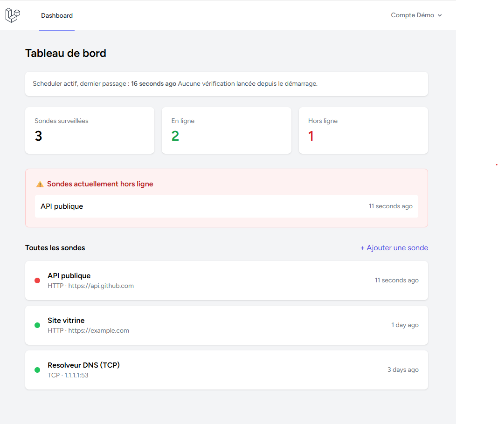
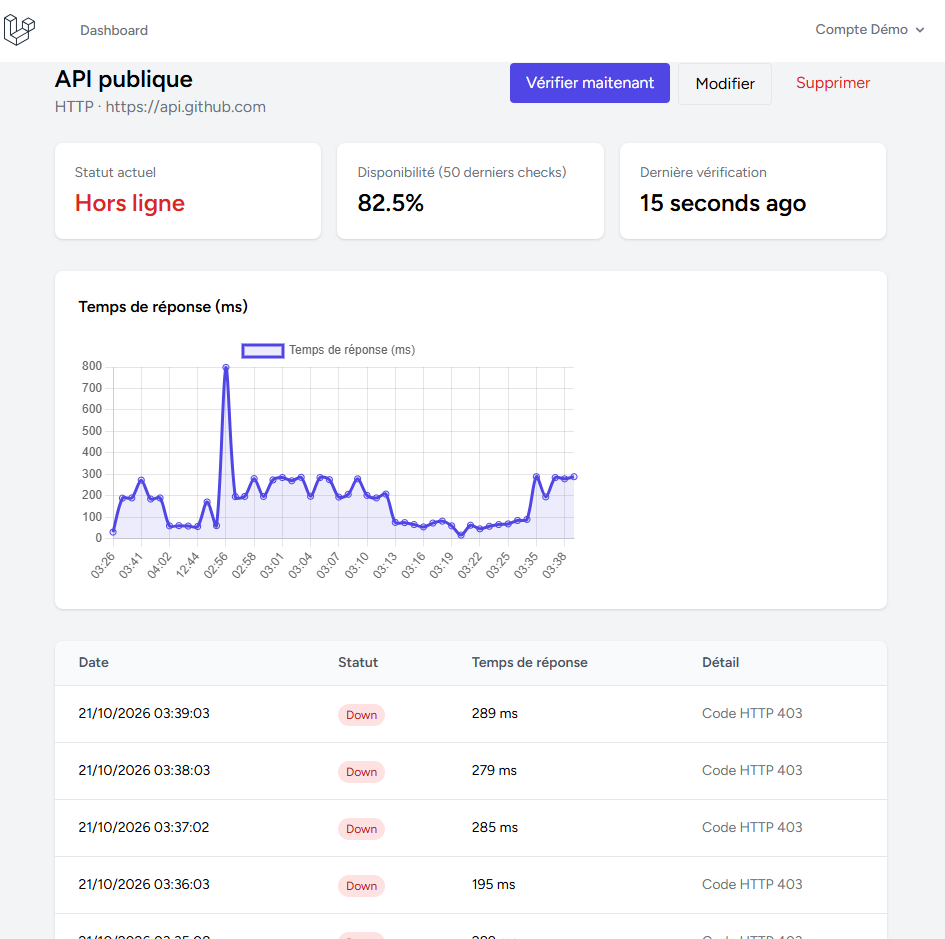
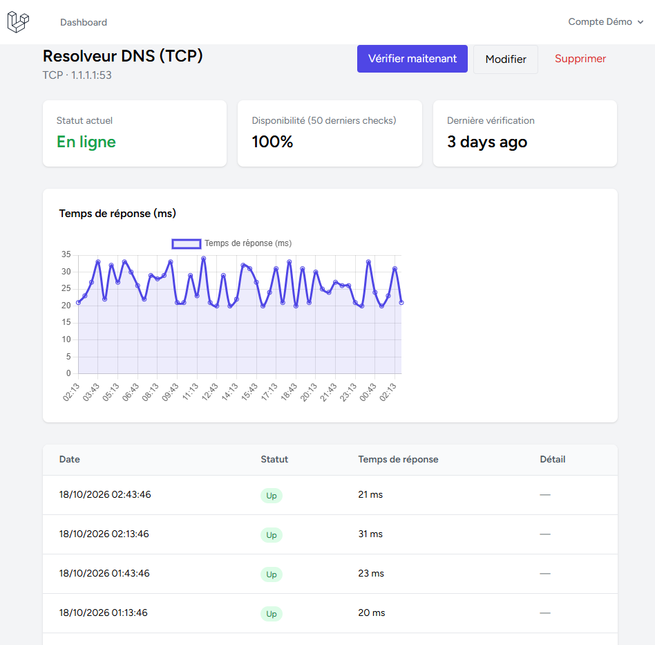

# 📡 Monitoring App — Laravel

Un outil de supervision de disponibilité : chaque utilisateur déclare des sondes (sites web, services TCP), l'application les vérifie automatique, conserve l'historique, trace l'évolution du temps de réponse et envoie une alerte lors d'un changement d'état.

## 🔗 Démo en ligne

👉 **[Voir le site en ligne](https://monitoring-app-juf3.onrender.com)**

### Compte de démonstration

| Email | Mot de passe |
|---|---|
|demo@example.com | password |

Le compte contient trois sondes avec 48 heures d'historique, dont un incident simulé. Le bouton **"Vérifier maintenant "** de chaque sonde lance une vraie vérification en direct.

### ⚠️ Limites de la démo (hébergement grauit)

- Le service se met en veille après 15 minutes sans visite, et le scheduler s'arrête avec lui. Il repart à la visite suivante (environ une minute de délai).
- Les emails d'alerte sont écrits dans les logs, car le plan gratuit bloque les ports SMTP.
- Un usage réel demande un worker permanent (service payant d'environ 7 $/mois, ou un petit serveur) et un fournisseur d'emails par API.

## ✨ Fonctionnalités 

- Sondes **HTTP** (code de statut, temps de réponse) et **TCP** (ouverture de port `host:port`)
- Intervalle de vérification configurable par sonde, activation/désactivation sans perte d'historique 
- Vérifications automatiques et récurrentes (Schedule + Jobs Laravel)
- **Alertes email uniquement lors d'un changement d'état** (panne ou retour à la normale), jamais à chaque vérification
- Dashboard : compteurs, sondes en panne mises en avant, état du scheduler
- Page de détail : taux de disponibilité, graphique du temps de réponse (Chart.js), historique avec message d'erreur
- Comptes multi-utilisateurs avec isolation stricte des données

## 🛠️ Stack technique

- **Backend** : Laravel 12, PHP 8.2
- **Frontend** : Blade, Tailwind CSS, Chart.js
- **Base de donées** : PostgreSQL (Neon)
- **Authentification** : Laravel Breeze
- **Déploiement** : Docker, Render

## 🧠 Choix techniques

- **Service de vérification dédié** (`ProbeCheckService`) : la logique réseau est isolée du reste de l'application, avec un `try/catch` explicite pour distinguer une réponse en erreur d'un serveur injoignable.
- **Détection de transition d'état** : le Job compare le résultat au dernier `Check` connu, ce qui évite d'envoyer des dizaines d'emails identiques pendant une longue panne.
- **Un seul scheduler pour des intervalles variables** : une commande exécutée chaque minute décide quelles sondes sont dues, plutôt qu'une tâche planifiée par sonde.
- **Jobs uniques par sonde** (`ShouldBeUnique`) : empêche d'empiler des vérifications en double si un worker prend du retard.
- **Protection contre la SSRF** : une règle de validation refuse les cibles qui résolvent vers des adresses privées ou réservées (localhost, réseaux internes, métadonnées cloud), et les redirections ne sont pas suivies.
- **Limitation de débit** sur le bouton de vérification manuelle, et platfond de sondes par compte.
- **Table d'historique immuable** : `checks` n'a ni `created_at` ni `updated_at`, seulement `checked_at`, puisqu'un résultat de vérification ne se modifie jamais.
- **Seeders idempotents**, pour pouvoir le déploiement sans doublons.

## 📸 Aperçu 





## ⚙️ Installation locale 

```bash
git clone https://github.com/zzres/monitoring-app.git
cd monitoring-app

composer install
npm install

cp .env.example .env
php artisan key:generate

# Configurer la base de données dans le fichier .env

php artisan migrate --seed
npm run build

php artisan serve
```

Pour activer les vérifications automatiques, lance dans deux autres terminaux : 

```bash
php artisan scheldule:work
php artisan queue:work
```

## 👤 Auteur 

Développé par Alvain Junior Saminzéré Zéro
Retrouvez-moi sur [Codeur.com](https://www.codeur.com/-alvainz23) pour vos projets de développement web.
